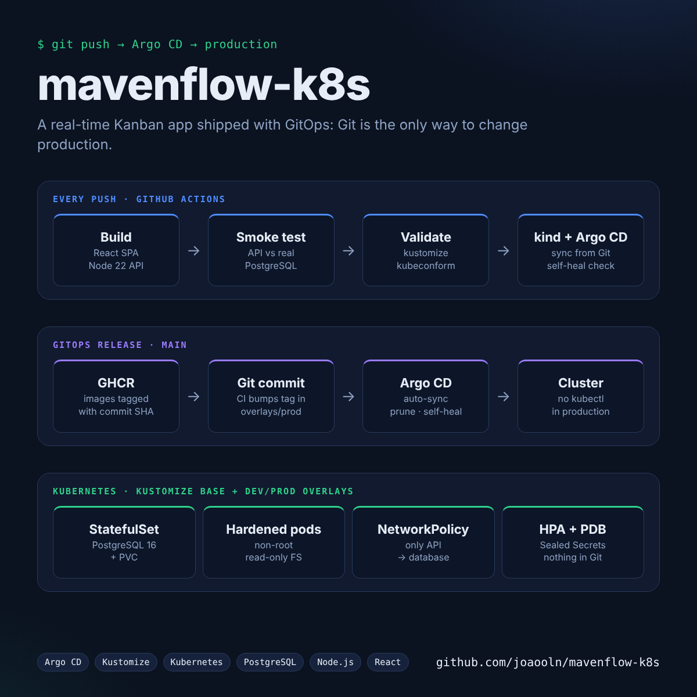
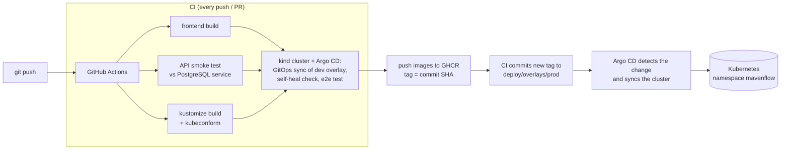
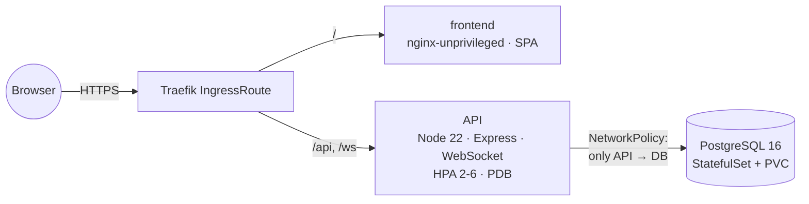

<div align="center">

# Mavenflow

**Real-time Kanban project manager, deployed on Kubernetes with GitOps**

[](https://github.com/joaooln/mavenflow-k8s/actions/workflows/ci.yml)


</div>

A Trello-style app (boards, cards, checklists, comments, real-time updates over WebSockets),
used here as a realistic three-tier workload to practice **Kubernetes operations and GitOps**:
Kustomize environments, a PostgreSQL StatefulSet, hardened pods, an end-to-end test on a real
cluster in CI, and Argo CD deploying whatever is on `main`.

## How a change reaches production





Git is the single source of truth: nobody runs `kubectl apply` against production. Argo CD
applies the prod overlay, prunes removed resources and reverts manual drift (`selfHeal`).

## Runtime architecture



## Kubernetes design

| Concern | Implementation |
| --- | --- |
| Environments | Kustomize `base` + `overlays/dev` (kind/CI) and `overlays/prod` (Argo CD) |
| Database | PostgreSQL **StatefulSet** with `volumeClaimTemplates` and a headless Service |
| Startup order | API `initContainer` waits for `pg_isready` before the app starts |
| Health | Readiness/liveness probes on every workload (`/api/health`, `/healthz`, `pg_isready`) |
| Availability | 2 replicas, `PodDisruptionBudget`, HPA on CPU in prod |
| Security | Non-root containers, `readOnlyRootFilesystem` on the API, all capabilities dropped, seccomp `RuntimeDefault`, no service account token, NetworkPolicy isolating the database |
| Secrets | Dev uses throwaway `secretGenerator` values; prod expects **Sealed Secrets** (nothing sensitive in Git) |
| Delivery | Images tagged with the commit SHA; CI bumps the prod overlay, Argo CD syncs it |
| GitOps tested in CI | Every run installs Argo CD in kind, lets it deploy the dev overlay from Git at that commit, then scales a Deployment by hand and checks that Argo CD reverts the drift |

## Repository layout

```
backend/                  Express API + WebSocket server (Node 22)
src/                      React 19 SPA (Vite)
deploy/
  base/                   postgres.yaml · api.yaml · frontend.yaml · networkpolicy.yaml
  overlays/dev/           kind/CI: dev secrets, 1 replica, local images
  overlays/prod/          Traefik IngressRoute, HPA, GHCR images (tag bumped by CI)
gitops/argocd/            Argo CD Application pointing at overlays/prod
scripts/smoke-test.sh     register → login → create board → list boards
.github/workflows/ci.yml  build, smoke test, manifest validation, kind e2e, release
```

## Run it

**Docker Compose**

```bash
docker compose up --build        # http://localhost:8080 (API on :3001)
```

**Local Kubernetes (kind)**

```bash
kind create cluster
docker build -t mavenflow-api:dev backend && docker build -t mavenflow-frontend:dev .
kind load docker-image mavenflow-api:dev mavenflow-frontend:dev
kubectl apply -k deploy/overlays/dev
kubectl -n mavenflow-dev port-forward svc/mavenflow-frontend 8080:80
```

**Production with Argo CD**

```bash
kubectl apply -n argocd -f gitops/argocd/application.yaml
```

## Secrets

Production secrets are encrypted with [Sealed Secrets](https://github.com/bitnami-labs/sealed-secrets)
so they can live in Git safely:

```bash
kubectl -n mavenflow create secret generic mavenflow-db \
  --from-literal=password="$(openssl rand -hex 24)" --dry-run=client -o yaml \
  | kubeseal -o yaml > deploy/overlays/prod/sealed-secrets.yaml
kubectl -n mavenflow create secret generic mavenflow-api \
  --from-literal=jwt-secret="$(openssl rand -hex 32)" --dry-run=client -o yaml \
  | kubeseal -o yaml >> deploy/overlays/prod/sealed-secrets.yaml
# then uncomment `sealed-secrets.yaml` in deploy/overlays/prod/kustomization.yaml
```

## Application features

- Email/password auth (bcrypt + JWT), per-board access control (owner / member)
- Kanban and list views with drag and drop
- Cards with labels, members, due dates, checklists, comments and activity log
- Real-time board updates and notifications over WebSockets
- Dashboard with overdue / upcoming cards and per-board progress

## Lessons learned

- The API crashed on start in Node 22 (`import ... assert {}` syntax was removed). The kind
  end-to-end test in CI now catches this class of bug before anything ships.
- WebSockets must switch to `wss://` behind HTTPS; the client now derives it from the page protocol.

## Roadmap

- [ ] Frontend lint clean-up and unit tests
- [ ] Database backups with a CronJob (`pg_dump` to object storage)
- [ ] Prometheus metrics and alerts for the API

## License

MIT
